<p align="center">
  
</p>

<h1 align="center">Overworld</h1>

<p align="center">
  A Claude Code plugin that drops your chat into one of ten pixel biomes,<br>
  and turns every subagent Claude sends out into a mob in your <b>Party</b>.
</p>

<p align="center">
  <a href="https://abdullahafaq.github.io/claude-overworld/">Website</a> ·
  <a href="#spawn-in">Install</a> ·
  <a href="#the-biomes">Biomes</a> ·
  <a href="#your-party">Party</a> ·
  <a href="#commands">Commands</a> ·
  <a href="#mod-it-yourself">Mod it</a>
  <br><br>
  <a href="https://github.com/abdullahafaq/claude-overworld/actions/workflows/checks.yml"></a>
  <a href="LICENSE"></a>
  <a href="#the-biomes"></a>
  <a href="#your-party"></a>
</p>

I spend most of my day in the Claude Code desktop app and wanted it to feel less like a blank window. Overworld puts a pixel biome behind the chat, recolours the whole app to match, and shows every subagent Claude sends out as a mob, so you can see who's working on what.

Everything you see here is my own pixel art, drawn in code. No textures, sprites or logos from any game.

## Spawn in

In the Claude Code desktop app's message box:

```
/plugin install overworld --marketplace abdullahafaq/claude-overworld
```

Accept the marketplace (`y`), choose a scope (**user** means every project gets it), then:

```
/overworld sakura
```

> [!NOTE]
> Backdrops need the **desktop app** (Code tab). I built this on v2.1.330, so a recent version is a good idea. The terminal and VS Code don't draw backdrops, but `/overworld` and the Party pane still work there, in text. Running another backdrop theme at the same time? Switch it off, only one gets the background.

## The biomes

<table>
  <tr>
    <td width="20%"><br><b>Sakura Night</b><br><code>/overworld sakura</code></td>
    <td width="20%"><br><b>Meadow</b> · light<br><code>/overworld meadow</code></td>
    <td width="20%"><br><b>Jungle</b><br><code>/overworld jungle</code></td>
    <td width="20%"><br><b>Desert Night</b><br><code>/overworld desert</code></td>
    <td width="20%"><br><b>Badlands</b><br><code>/overworld badlands</code></td>
  </tr>
  <tr>
    <td width="20%"><br><b>Aurora</b><br><code>/overworld aurora</code></td>
    <td width="20%"><br><b>Ocean</b><br><code>/overworld ocean</code></td>
    <td width="20%"><br><b>The End</b><br><code>/overworld end</code></td>
    <td width="20%"><br><b>Nether</b><br><code>/overworld nether</code></td>
    <td width="20%"><br><b>Deep Dark</b><br><code>/overworld deep</code></td>
  </tr>
</table>

Each one is a moving scene behind the conversation *and* a full recolour of the app (panels, text, links, code, diffs). Nine are dark, Meadow is the light one. Here's what's going on in each:

- **Sakura Night** · pink. My default. A pink moon over cherry trees, paper lanterns swinging on their strings, petals drifting down at their own pace, the moon reflected in the pond. A fox and a frog by the water.
- **Meadow** · green, light. A sunny morning in the plains: clouds rolling across, a tiny house, flowers in the grass, a cat, and a bee that won't sit still.
- **Jungle** · green. Giant two-wide jungle trees with vines swaying off the canopy, cocoa pods, bamboo, a mossy temple poking out between the trunks, and fireflies. A panda and a parrot.
- **Desert Night** · gold. A sky full of stars over the dunes and a temple with two candles flickering at the door. A tumbleweed rolls past every minute or so. A creeper and a cat.
- **Badlands** · orange. Striped terracotta mesas glowing at sunset, an old mineshaft cut into the cliff, dead bushes, dust blowing past. An armadillo and a wolf.
- **Aurora** · mint. Northern lights breathing over a frozen taiga, snow coming down, an igloo, and a snow fox with a wolf for company.
- **Ocean** · blue. The sea floor: slow light beams, swaying kelp, coral, a shipwreck, two schools of fish, an axolotl, and a glow squid with bubbles rising off it.
- **The End** · violet. End city towers with glowing windows, crystals humming on obsidian pillars, chorus plants, and a dragon that glides across every so often. Two endermen.
- **Nether** · crimson. A fortress bridge over a lava sea, two lavafalls, glowstone in the ceiling, crimson fungi with shroomlights, ash floating up, a ghast drifting in the haze. A strider and a magma cube.
- **Deep Dark** · black with teal. An ancient city lit by soul lanterns and candles, sculk pulsing along the floor, a shrieker, and the warden, whose chest glows with its heartbeat. The one I use most late at night.

Every mob bobs and blinks, and the ones with legs shuffle in place.

## Your party

When Claude sends out a subagent, it spawns into the **Party** pane as a mob, and it stays there while it works:

```
PARTY                          2 out · 55.8k tokens
 🦜  Explore · haiku-5-5
     Find where the header is positioned
     ↳ Grep "position: fixed" src/
     XP ▰▰▰▰▰▱▱▱▱▱ 24.6k · 48s            + trail

BACK AT SPAWN · 3 · 1 didn't make it
 🐺  code-reviewer       Review the header diff · 12.9k · 37s
 🟩  test-runner · blew up   Run the e2e suite · 9.0k · 1m 4s
```

*(In the app those are proper pixel mobs, not emoji.)*

Who turns up as what:

- **Fox:** `general-purpose`, the all-rounder.
- **Parrot:** `Explore`, off scouting the codebase.
- **Panda:** `Plan`, sitting down to think first.
- **Wolf:** anything that reviews, audits or checks security.
- **Creeper:** test, build, lint and e2e runners. If the run fails, it **blew up**.
- **Bee:** `web-fetch`, research and docs.
- **Axolotl, frog, cat, enderman, strider, armadillo:** your own custom agents. Each type always gets the same one.

Each card shows the tool it's on right now, an XP bar that fills as its context grows, the exact token count from the API, and how long it's been out. **+ trail** opens its last few tool calls. A failed run says so in words, not just in colour.

The pane opens itself the first time an agent spawns. Close it and it stays closed until `/overworld party on`.

## Commands

```
/overworld                  list every biome (the one you're in is marked)
/overworld <biome>          sakura · meadow · jungle · desert · badlands
                            aurora · ocean · end · nether · deep
/overworld random           pick one at random
/overworld still            freeze the scene, keep the colours (good on battery)
/overworld moving           unfreeze
/overworld party off        close the Party pane for good
/overworld party on         bring it back
/overworld off              plain Claude Code again
```

Your biome sticks across sessions. Switched while a chat was already open and nothing changed? `/reload-plugins` (or just send a message) and it'll draw.

> [!TIP]
> Leave the right-hand side panel open. The mobs stand in the strip between the conversation and that panel, so they're always in view and never behind your text.

## Mod it yourself

Every biome is a short TypeScript file and every mob is a few rows of letters, so Claude can change any of it for you. Fork the repo, open it in Claude Code, and say *"use this folder for the overworld plugin instead of the installed one"*. Then just ask:

> *"Give the Meadow a few sheep."* · *"Make Desert Night a sandstorm."* · *"Put a cat in the Deep Dark."* · *"Recolour the Nether blue, scene and palette."*

After a change: `/reload-plugins`, then `/overworld <biome>`. Before you share it, `npm run verify` checks it's still readable, calm and safe.

**Adding a biome**

| What | Where |
| --- | --- |
| a palette (4 surfaces, 3 text shades, 5 accents) | `plugins/overworld/hooks/palettes.ts` |
| a scene, built from the kit and the scenery | `plugins/overworld/hooks/scenes/<id>.ts` (+ `pixels.ts`, `props.ts`) |
| an entry with a title, blurb and glass tint | `plugins/overworld/hooks/biomes.ts` |
| then re-render the README and site art | `npm run art` |

Mobs live in `mobs.ts`. A mob is a map of letters, one letter per pixel. Here's the fox's head end:

```
...........O.O..     O fur   o belly   W chest and tail tip
..........OOOOO.     K nose and paws   E eye (it blinks)
..........OEOOOO
WO........OOOWWK
```

Change the letters, change the mob. Which mob each agent type gets is the `CAST` list at the top of `party.tsx`.

## Easy on the eyes

I keep this open for hours, so readability isn't optional. `scripts/check-biomes.mjs` runs on every push and fails the build if any of this slips:

- **Contrast.** Primary text is 13:1 or more on every surface of every biome (WCAG AAA is 7:1). Secondary text, muted text and accents are 6:1 or more (AA is 4.5:1).
- **Calm motion.** Everything moves in slow, chunky steps. No animation loops faster than once a second, and nothing flashes.
- **Reduce motion.** Turn it on in your system settings and every scene becomes a still that still looks finished. `/overworld still` does the same just for Overworld.
- **Glass under text.** The conversation sits on frosted, tinted glass. The busy parts of each scene live in the margins.
- **Not colour alone.** Failure is written out (*failed*, *blew up*), and the Party pane reads fine as plain terminal text.
- **Described.** Every scene and every mob has alt text for screen readers.

Something hard to read for you? [Open an issue](https://github.com/abdullahafaq/claude-overworld/issues/new/choose), I'll fix it.

## What it touches (and what it doesn't)

| | |
| --- | --- |
| **Reads** | Agent events from Claude Code itself: which agent spawned, the tool it's calling (with its command or path), its token usage, when it finished. Never the contents of your files. |
| **Saves** | Three settings, on your machine: your biome, motion on or off, and whether the Party pane is closed. |
| **Keeps in memory** | The Party cards, for this session only. Commands and task text are shortened, and anything shaped like a key, token or `password=` is masked before it's stored. All shown as plain text, never links. |
| **Never** | Network, files, processes, models, other plugins' tool calls. No dependencies. |

The scenes are plain SVG with CSS animation: no scripts, links, images or remote anything, and the checks reject one that tries. `claude plugin validate plugins/overworld` prints every hook and API call the plugin uses if you want to see for yourself. Security problem? Please report it privately, see [SECURITY.md](SECURITY.md).

## Under the hood

It's a Claude Code [mod](https://code.claude.com/docs/en/plugins/mods/overview): a TypeScript module the app loads at session start.

| Event | What Overworld does |
| --- | --- |
| `session.start` | registers `/overworld`, sets your saved biome with `$.theme.set` |
| `command.run` | handles `/overworld …` |
| `ui.render` · Backdrop | draws the biome's SVG behind the chat |
| `agent.spawn` | adds a mob to the Party and opens the pane |
| `tool.call` | updates that agent's tool line and trail |
| `turn.step` | records its token count from the API's usage |
| `turn.complete` | moves it to *back at spawn* (or *blew up*) |
| `ui.render` · Pane | draws the Party |

```
.claude-plugin/marketplace.json      makes this repo installable
plugins/overworld/                   the plugin (the only folder that gets installed)
├─ .claude-plugin/plugin.json, icon.png
├─ hooks/
│  ├─ register.tsx                   entry point: /overworld, theme, backdrop
│  ├─ party.tsx                      the Party pane
│  ├─ biomes.ts · palettes.ts        the biome list and its colours
│  ├─ pixels.ts · props.ts · mobs.ts drawing kit, scenery, mob sprites
│  ├─ scenes/                        one file per biome
│  └─ privacy.ts                     masking and trimming
├─ types/index.d.ts                  the Party's session-state contract
└─ tests/                            run by `claude plugin test`
scripts/
├─ check-biomes.mjs                  contrast, motion and scene checks
├─ render-art.mjs · trailer.mjs      all README and site art, from the real code
└─ resolve-ts.mjs                    lets plain Node run the TypeScript
assets/                              rendered art for this README
docs/                                the website
```

Colours go through `makeColors`, the helper Claude Code ships for mods, which expands a dozen colours into everything the app paints and warns about anything it won't. Scenes are pure functions, so the same code always draws the same picture.

## Hacking on it

Node 23.6+ runs everything straight from the TypeScript, nothing to install.

```bash
npm run check:biomes   # contrast, motion, scene safety
npm test               # claude plugin validate + the plugin's tests
npm run art            # re-render the trailer, previews and site art
npm run verify         # check:biomes + test
```

Run `npm run art` after touching a scene or a mob; CI fails if the committed art doesn't match the code. (The icon PNG needs Playwright; everything else doesn't.) [CONTRIBUTING.md](CONTRIBUTING.md) has the longer version.

## Questions

**I installed it and nothing changed?**
Backdrops only show in the desktop app's Code tab. If you're there, try `/reload-plugins`, then `/overworld sakura`.

**Can I use it in the terminal?**
Kind of. `/overworld` works and the Party pane shows up as text, but terminals don't draw backdrops.

**Does it drain battery?**
Barely. Scenes step at about eight frames a second instead of sixty, and the Party only ticks while an agent is actually out. `/overworld still` takes the scene down to basically zero.

**Will it ever see my code?**
Not your files. It sees what your agents are doing (the tool and the command or path it's on) so it can show you, masks anything secret-looking, and forgets it all when the session ends. No file, network or process access.

**Can I make my own biome?**
Yes. See [Mod it yourself](#mod-it-yourself).

**Did Mojang make this?**
No. It's a fan project, see below.

## Thanks & legal

Made by [Abdullah Afaq](https://github.com/abdullahafaq) and Claude. It's a Claude Code plugin, so that second one was a given.

Overworld is an unofficial fan project inspired by Minecraft. It is **not an official Minecraft product** and is not approved by or associated with Mojang or Microsoft. All mobs, blocks and scenes are original pixel art; no game assets, textures, sounds, fonts or logos are used. It isn't affiliated with Anthropic either.

[MIT licensed](LICENSE). The `make-colors` helper files are Claude Code's own and keep their original terms, see [NOTICE](NOTICE).
